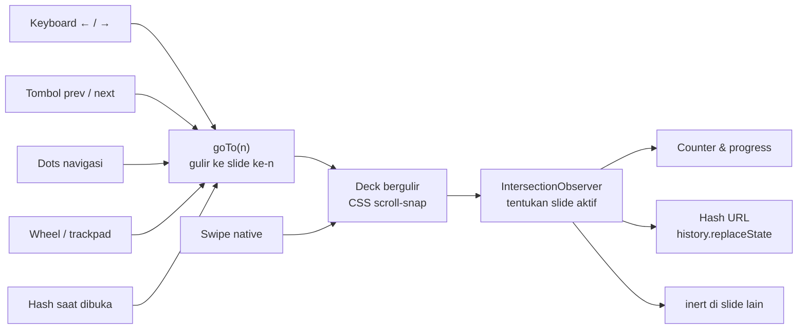

# PRD — Website Portofolio Gaya Slide (PPT)

Oct 14, 2026 · @Tehcun

## Ringkasan & Tujuan

Website portofolio pribadi satu halaman yang tampil seperti presentasi PowerPoint: tiap bagian adalah satu slide layar penuh, dan pengunjung berpindah slide ke kanan atau kiri. Situs statis dibangun dengan Astro, di-deploy di Vercel.

**Tujuan**

- Pengunjung paham siapa saya, keahlian saya, dan cara menghubungi saya dalam kurang dari 60 detik.
- Navigasi terasa seperti presentasi: satu ide per slide, perpindahan halus, bisa dikontrol keyboard.
- Mudah dirawat: menambah proyek baru cukup menambah satu file Markdown di `src/content/projects/`, slide-nya dibuat otomatis.

**Metrik sukses**

- Lighthouse mobile ≥ 90 untuk Performance, Accessibility, Best Practices, dan SEO.
- Total JavaScript < 5 KB; halaman pertama (di luar gambar proyek) < 200 KB.
- Slide Kontak dan tombol unduh CV bisa dicapai dalam ≤ 2 aksi dari mana saja.

## Target Pengguna

Pembaca utama adalah recruiter yang membuka tautan dari CV atau LinkedIn, sering lewat HP, dan hanya memindai kurang dari satu menit.

| Pengguna | Yang dicari | Slide yang menjawab |
| --- | --- | --- |
| Recruiter / HR | Peran, pengalaman, CV | Cover, Pengalaman, Kontak (unduh CV) |
| Hiring manager / tech lead | Kedalaman teknis, proyek nyata | Keahlian, Proyek |
| Calon klien freelance | Contoh hasil kerja, cara kontak | Proyek, Kontak |
| Rekan / komunitas | Profil singkat, tautan sosial | Tentang Saya, Kontak |

## Struktur Slide & Konten

Isi diambil dari `docs/Sahrul Romadi — Interview Portfolio.pptx` dan ditulis dalam **bahasa Inggris**, mengikuti deck aslinya. Totalnya 7 slide, berurutan dari kiri ke kanan. Aturan: satu ide per slide, dan konten muat di layar 1366×768 tanpa scroll.

| # | Slide | Isi | Hash URL |
| --- | --- | --- | --- |
| 1 | Cover (gelap) | Software Engineer · 2 years of experience, nama, branding **Enterprise Digitalization** + satu kalimat positioning sebagai developer yang fokus pada digitalisasi, kontak berikon | `#home` |
| 2 | Experience | 4 posisi (2024 → sekarang) sebagai timeline | `#experience` |
| 3 | Applications I Built & Maintain | Diagram lingkaran: Shared Services (Email, Blob, Mekari Talenta ETL) di tengah, terhubung ke 6 divisi di sekelilingnya; CPS Automation (berlabel *Service*) punya lingkaran sendiri dengan garis ke Plant & Procurement. Total 19 aplikasi | `#applications` |
| 4–6 | Proyek (1 slide per proyek): HSE Platform, Plant Inventory, HRIS | Divisi, deskripsi proyek, angka utama, Before / What I built / After | `#project-<slug>` |
| 7 | Penutup (gelap) | Quote “What drives my work”, kontak, tombol unduh CV (muncul hanya jika `public/cv.pdf` ada) | `#contact` |

Slide dashboard dan gambar screenshot dari deck **tidak dipakai** untuk saat ini.

Di HP, slide yang kontennya lebih tinggi dari layar boleh di-scroll vertikal di dalam slide itu sendiri.

## Kebutuhan Fungsional

Semua cara navigasi harus berpindah tepat satu slide per aksi, dan posisi slide selalu tercermin di URL serta indikator.

| ID | Kebutuhan | Prioritas |
| --- | --- | --- |
| F1 | Slide layar penuh (`100vw × 100dvh`) tersusun horizontal, berhenti pas di batas slide (CSS scroll-snap) | Wajib |
| F2 | Keyboard: ←/→, PageUp/PageDown, Spasi, Home/End | Wajib |
| F3 | Swipe kiri/kanan di layar sentuh (native, tanpa library) | Wajib |
| F4 | Tombol panah prev/next di layar; disembunyikan di slide pertama/terakhir | Wajib |
| F5 | Indikator posisi: nomor “3 / 8” + progress bar tipis di bawah | Wajib |
| F6 | Deep link: hash URL ikut slide aktif (pakai `history.replaceState`, agar tombol Back tidak penuh riwayat slide); membuka `/#contact` langsung ke slide Kontak | Wajib |
| F7 | Tombol unduh CV (PDF) di slide Kontak | Wajib |
| F8 | Scroll wheel / trackpad vertikal memindahkan slide horizontal; satu gesture = satu slide (dengan jeda/debounce) | Penting |
| F9 | Titik navigasi (dots) yang bisa diklik untuk lompat ke slide tertentu | Penting |

## Kebutuhan Non-Fungsional

Situs harus cepat dan bisa dipakai di HP serta oleh pengguna keyboard dan screen reader, karena recruiter membukanya dari mana saja.

| Aspek | Target |
| --- | --- |
| Responsif | Lebar 360–2560 px, portrait dan landscape; di HP tetap swipe horizontal |
| Performa | LCP < 2,5 detik di 4G; gambar WebP/AVIF dengan `loading="lazy"` kecuali slide 1; maksimal 2 weight font dengan `font-display: swap` |
| Aksesibilitas | Tiap slide `<section aria-roledescription="slide" aria-label="3 dari 8: Proyek">`; slide di luar layar diberi `inert` agar Tab hanya di slide aktif; fokus keyboard terlihat; kontras WCAG AA |
| Gerak | `prefers-reduced-motion: reduce` → perpindahan slide tanpa animasi |
| SEO & berbagi | Semua teks di HTML (bukan gambar/canvas); `<title>`, meta description, Open Graph + gambar 1200×630, favicon |
| Browser | Dua versi terakhir Chrome, Edge, Firefox, Safari (macOS dan iOS) |
| Privasi | Tanpa cookie. v2 mencatat IP, user agent, dan waktu buka ke database sendiri |
| Visual | Palet dari tema deck: navy `#14213D`, krem `#F7F5EF`, emas `#8A6A2A`, amber `#E8A33D` (amber hanya di atas navy). Cover & penutup gelap dengan cahaya gradasi, slide isi terang. Font sistem (Inter + Space Grotesk dari deck belum dipasang) |

## Tech Stack & Arsitektur

Stack: Astro dengan output statis. Astro menghasilkan HTML biasa dan tidak mengirim JavaScript ke browser kecuali diminta, jadi situs tetap secepat HTML manual. Efek slide horizontal tetap dari CSS `scroll-snap`; JavaScript (± 60 baris) hanya untuk navigasi.

- **Kenapa Astro:** tiap proyek ditulis sebagai satu file Markdown (content collection) dan slide-nya dibuat otomatis; komponen `<Slide>` menghindari copy-paste HTML; siap kalau nanti ditambah blog.
- **Kenapa bukan Next.js:** membawa runtime React yang tidak diperlukan untuk deck statis.
- **Tanpa integrasi tambahan di v1:** tidak perlu React, Tailwind, atau adapter Vercel; cukup Astro + CSS biasa.

**Struktur file**

```
ppt-portfolio/
├── astro.config.mjs
├── package.json
├── public/
│   ├── cv.pdf
│   └── og.png              # 1200×630 untuk preview link
└── src/
    ├── content.config.ts   # skema koleksi proyek
    ├── content/projects/   # 1 file .md per proyek
    ├── assets/             # screenshot proyek (dioptimasi Astro)
    ├── components/
    │   ├── Deck.astro      # wadah slide + script navigasi
    │   └── Slide.astro
    ├── styles/global.css
    └── pages/index.astro   # susun semua slide
```

**Inti layout**

```css
.deck  { display: flex; height: 100dvh; overflow-x: auto;
         scroll-snap-type: x mandatory; scroll-behavior: smooth; }
.slide { flex: 0 0 100vw; scroll-snap-align: start; overflow-y: auto; }
@media (prefers-reduced-motion: reduce) { .deck { scroll-behavior: auto; } }
```

**Data proyek** — satu file per proyek di `src/content/projects/`; urutan slide mengikuti `order`.

```markdown
---
title: Plant Inventory
order: 2
division: Plant
summary: Inventory management application for the Plant division, shared by both sites on one set of records.
stat: { value: '2', label: sites }
before: Inventory was managed in Excel, and the data at each site was different.
built:
  intro: 'A website that manages:'
  items: [Stock in and stock out, Lending and borrowing, Stock transfer]
  note: I also fixed the data so sites share the same records.
after:
  - All assets at each site are monitored
  - Min and max stock levels are visible
---
```

Data profil, pengalaman, dan daftar aplikasi per divisi ada di bagian atas `src/pages/index.astro`.

**Alur navigasi**



Counter, hash, dan `inert` hanya diubah oleh observer, jadi tampilan tetap benar apa pun cara pengunjung berpindah slide — termasuk swipe yang tidak melewati JavaScript.

## Deploy ke Vercel

Deploy lewat integrasi GitHub: tiap push ke `main` otomatis jadi production, tiap branch lain dapat URL preview sendiri.

1. Buat proyek: `npm create astro@latest` (template minimal), lalu `npm run dev` untuk preview di `localhost:4321`.
2. Push ke repo GitHub (boleh privat).
3. Di Vercel: **Add New → Project → Import** repo tersebut.
4. Framework Preset **Astro** terdeteksi otomatis: Build Command `npm run build`, Output Directory `dist`. Tidak perlu diubah.
5. Klik **Deploy** → situs aktif di `<nama-proyek>.vercel.app`.
6. Opsional: **Settings → Domains** untuk domain sendiri, lalu tambahkan record DNS sesuai instruksi Vercel.

Output statis tidak butuh adapter `@astrojs/vercel` atau `vercel.json`. Adapter baru perlu kalau nanti ada fitur server, yaitu endpoint tracking di v2 (`npx astro add vercel`). Alternatif tanpa GitHub: `npx vercel` dari folder proyek.

## Roadmap v2 & Di Luar Cakupan

v2 berisi dua fitur: overview mode dan tracking pengunjung. **Mode gelap dibatalkan.** Fitur lain ditunda sampai v2 live.

**v2 — disepakati**

- **Overview mode** — tekan `O` → semua slide tampil sebagai grid thumbnail (seperti Slide Sorter di PowerPoint); klik atau Enter untuk lompat, `O`/`Esc` untuk keluar. Juga lewat tombol grid di bar navigasi. Cukup toggle class `overview` yang mengubah deck jadi grid + CSS `zoom` per slide, tanpa library.
- **Tracking pengunjung** — catat IP, user agent, dan waktu buka tiap kunjungan. Detail di bagian berikutnya.

**Ditunda (belum dijadwalkan)**

- Cetak / simpan PDF: `@media print` satu slide per halaman.
- Animasi masuk elemen di tiap slide; otomatis mati saat reduced-motion.
- Dua bahasa (ID/EN) dengan routing i18n bawaan Astro.
- Blog — tinggal tambah koleksi `posts` di Astro.

**Di luar cakupan**

- CMS atau panel admin — konten diedit di file Markdown di repo.
- Form kontak dengan backend — cukup tautan `mailto:` dan LinkedIn.
- React/Next.js.
- Identifikasi perusahaan lewat IP (reverse-IP) — layanan berbayar, tidak akurat untuk jaringan seluler/rumah, dan menyentuh data pribadi.

## Tracking Pengunjung (v2)

v2 mencatat tiga hal tiap kali halaman dibuka: IP, user agent, dan waktu. Datanya disimpan di tabel Postgres milik sendiri di **Supabase** (lewat integrasi Supabase di Vercel Marketplace) oleh satu endpoint Astro. Tanpa library tambahan: endpoint memanggil REST API Supabase dengan `fetch`. Umami dan Vercel Analytics tidak dipakai karena keduanya tidak menyimpan IP mentah.

**Alur**

1. Halaman selesai dimuat → browser memanggil `navigator.sendBeacon('/api/hit')`.
2. Endpoint `/api/hit` membaca IP dari header `x-real-ip` (diisi Vercel, tidak bisa dipalsukan pengunjung) dan user agent dari header `user-agent`.
3. Endpoint mengirim `POST {SUPABASE_URL}/rest/v1/portfolio_visits` dengan secret key di header `apikey`; kolom waktu diisi otomatis oleh database.
4. Data dilihat lewat Table Editor atau SQL Editor di dashboard Supabase.

Halaman tetap statis; hanya `/api/hit` yang berjalan sebagai function. Pengunjung tanpa JavaScript (kebanyakan bot) tidak tercatat. Tanpa `SUPABASE_URL` / `SUPABASE_SECRET_KEY` (lokal, preview) endpoint membalas 204 tanpa menyimpan.

**Tabel** — sudah dibuat di project Supabase (region Tokyo, `ap-northeast-1`) pada 2026-10-14

```sql
create table public.portfolio_visits (
  id bigint generated always as identity primary key,
  visited_at timestamptz not null default now(),  -- waktu halaman dibuka (UTC)
  ip_address text not null,                       -- IP publik pengunjung, dari header x-real-ip Vercel
  user_agent text not null                        -- user agent browser, maks. 512 karakter
);
-- RLS aktif tanpa policy: publishable key tidak bisa membaca/menulis; hanya secret key (server) yang bisa.
alter table public.portfolio_visits enable row level security;
grant insert on public.portfolio_visits to service_role;
```

Sudah diuji langsung: secret key bisa insert (HTTP 201), publishable key ditolak saat insert (401) dan membaca 0 baris.

**Endpoint** — `src/pages/api/hit.ts`

```ts
import type { APIRoute } from 'astro';

export const prerender = false; // satu-satunya route yang tidak statis

const { SUPABASE_URL, SUPABASE_SECRET_KEY } = process.env;

export const POST: APIRoute = async ({ request }) => {
  // Kunjungan saat dev = kunjungan sendiri; preview tanpa env var tidak punya tujuan.
  if (import.meta.env.DEV || !SUPABASE_URL || !SUPABASE_SECRET_KEY) return new Response(null, { status: 204 });

  const row = {
    ip_address: request.headers.get('x-real-ip') ?? '',
    user_agent: (request.headers.get('user-agent') ?? '').slice(0, 512),
  };
  const res = await fetch(`${SUPABASE_URL}/rest/v1/portfolio_visits`, {
    method: 'POST',
    headers: { apikey: SUPABASE_SECRET_KEY, 'Content-Type': 'application/json', Prefer: 'return=minimal' },
    body: JSON.stringify(row),
  });
  if (!res.ok) console.error('portfolio_visits insert failed', res.status, await res.text());
  return new Response(null, { status: 204 });
};
```

**Di halaman** — satu baris di akhir script `Deck.astro`: `navigator.sendBeacon('/api/hit');`

**Setup**

1. ~~Buat tabel~~ — sudah dibuat.
2. Vercel → proyek → **Settings → Environment Variables**: isi `SUPABASE_URL` dan `SUPABASE_SECRET_KEY` (nilainya sama dengan di `.env` lokal; `.env` tidak ikut ter-deploy).
3. Redeploy agar environment variable terbaca.

Kunjungan dari `npm run dev` sengaja tidak dicatat; data baru masuk dari situs yang sudah di-deploy.

**Melihat data** — Table Editor → `portfolio_visits`, atau SQL Editor:

```sql
select visited_at at time zone 'Asia/Jakarta' as waktu, ip_address, user_agent
from portfolio_visits
order by visited_at desc
limit 100;
```

Batasan: endpoint publik tanpa rate limit, jadi siapa pun bisa mengirim baris palsu; tambahkan rate limit kalau itu terjadi. Tiap refresh = satu baris baru. Secret key hanya ada di server (env Vercel), tidak pernah dikirim ke browser.

## Milestone & Kriteria Selesai

Lima milestone berurutan (M1–M4 = v1, M5 = v2); deploy ke Vercel sudah dilakukan di milestone pertama supaya tiap perubahan langsung bisa dicek di URL asli.

1. **M1 Kerangka** — proyek Astro, komponen `Deck` + `Slide`, 6 slide placeholder, CSS scroll-snap, deploy pertama ke Vercel.
2. **M2 Navigasi** — keyboard, tombol, counter, progress bar, hash URL, wheel, dots.
3. **M3 Konten** — isi semua slide, koleksi proyek (Markdown), screenshot, CV PDF, meta tag dan gambar OG.
4. **M4 Poles** — responsif, aksesibilitas, Lighthouse ≥ 90, uji di HP Android dan iPhone nyata. v1 rilis.
5. **M5 v2** — overview mode, tracking IP, user agent, dan waktu buka ke Supabase.

**Kriteria selesai v1**

- [ ] ←/→ berpindah tepat satu slide; Home/End ke slide pertama/terakhir.
- [ ] Swipe di HP berhenti tepat di batas slide, tidak berhenti di tengah dua slide.
- [ ] Satu gesture trackpad atau satu putaran wheel = pindah satu slide, bukan loncat beberapa.
- [ ] Membuka `/#contact` langsung menampilkan slide Kontak.
- [ ] Counter dan hash URL selalu sesuai slide yang tampil, termasuk setelah swipe.
- [ ] Konten tiap slide terbaca di 360×640 dan 1366×768.
- [ ] Tombol Tab hanya memfokus elemen di slide aktif.
- [ ] Dengan reduced-motion aktif, perpindahan slide tanpa animasi.
- [ ] Lighthouse mobile ≥ 90 untuk keempat kategori.
- [ ] Push ke `main` memicu deploy production otomatis di Vercel.

**Kriteria selesai v2**

- [ ] `O` membuka overview grid; klik atau Enter lompat ke slide itu; `O`/`Esc` menutup.
- [ ] Membuka situs dari HP → satu baris baru di `portfolio_visits` berisi IP publik HP, user agent-nya, dan waktu yang benar (WIB).
- [ ] Halaman selain `/api/hit` tetap statis (di Vercel hanya ada satu function).
- [ ] Lighthouse tetap ≥ 90 setelah tracking terpasang.

## Pertanyaan Terbuka

Empat pertanyaan pertama sudah terjawab dari deck interview; sisanya masih terbuka.

- [x] Nama, peran, dan tagline untuk slide Cover? → Sahrul Romadi, Software Engineer, Enterprise Digitalization.
- [x] Berapa proyek yang ditampilkan? → 3 studi kasus (HSE, Plant Inventory, HRIS). Aplikasi internal, jadi tanpa link demo/repo.
- [x] Bahasa situs? → Inggris.
- [x] Gaya visual? → Mengikuti tema deck (navy, krem, emas).
- [ ] Domain sendiri atau cukup `*.vercel.app`?
- [ ] Di HP: tetap swipe horizontal (default PRD ini) atau berubah jadi scroll vertikal?
- [ ] File `public/cv.pdf` dan `public/og.png` (1200×630).

## Sumber

- [Vercel — Request headers](https://vercel.com/docs/headers/request-headers) (`x-real-ip`, `x-forwarded-for`)
- [Supabase — API keys](https://supabase.com/docs/guides/api/api-keys) (secret key di header `apikey`, bypass RLS)
- [Vercel Marketplace — Supabase](https://vercel.com/marketplace/supabase) (env var `SUPABASE_URL`, `SUPABASE_SECRET_KEY`)
- [Vercel — Pricing for Web Analytics](https://vercel.com/docs/analytics/limits-and-pricing)
- [Umami — Pricing](https://umami.is/pricing)
